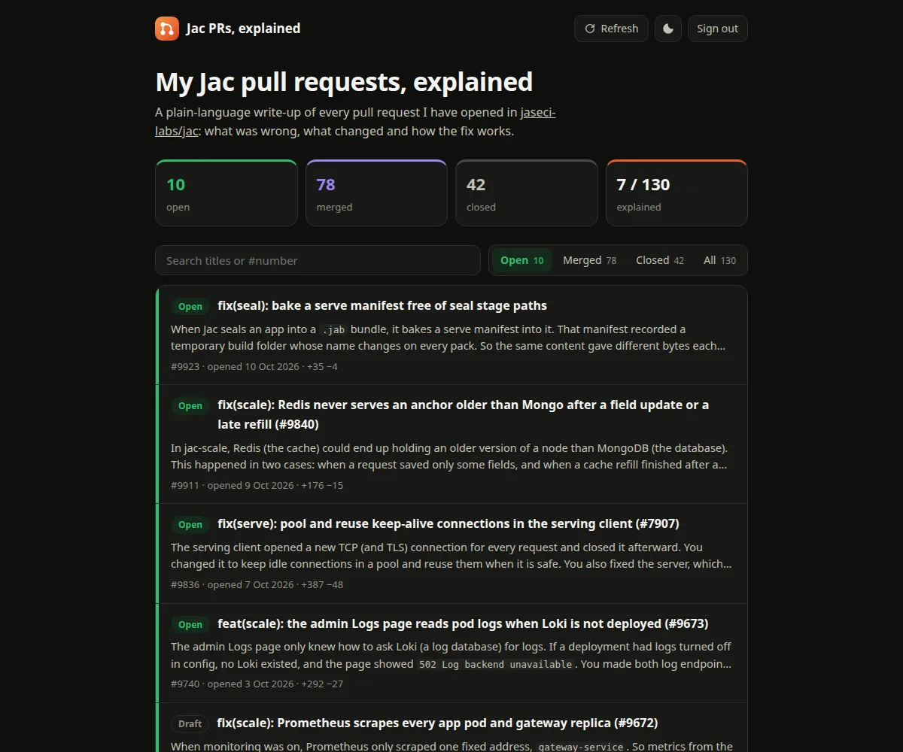
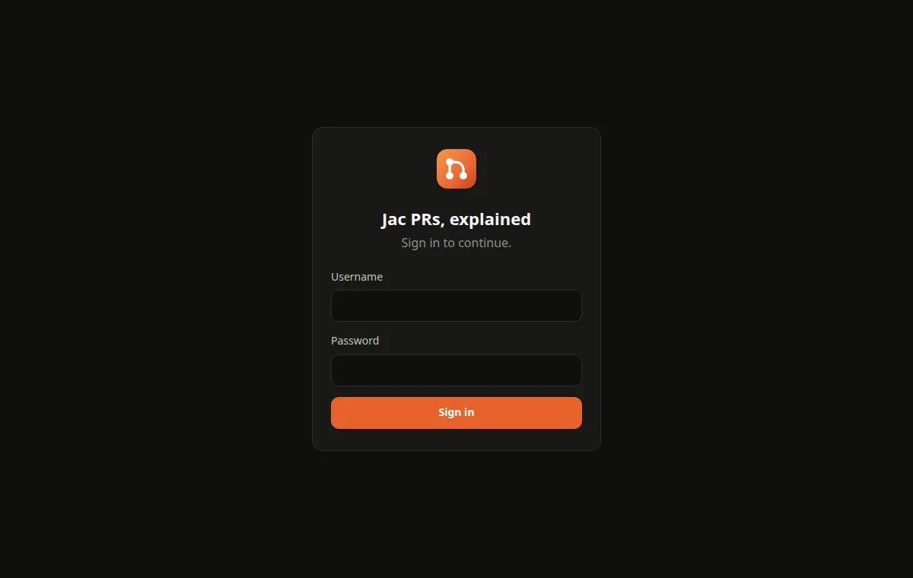
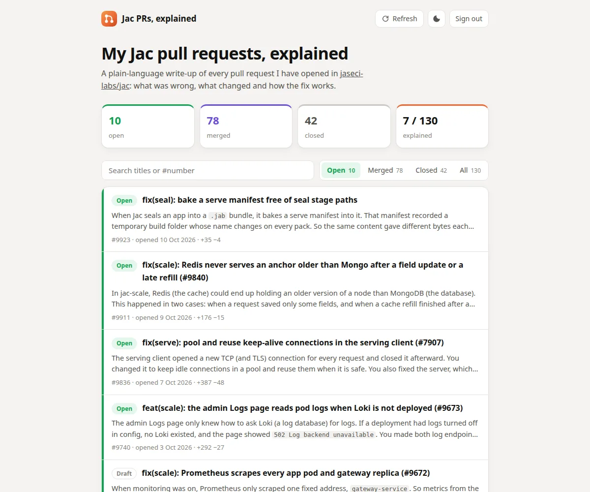
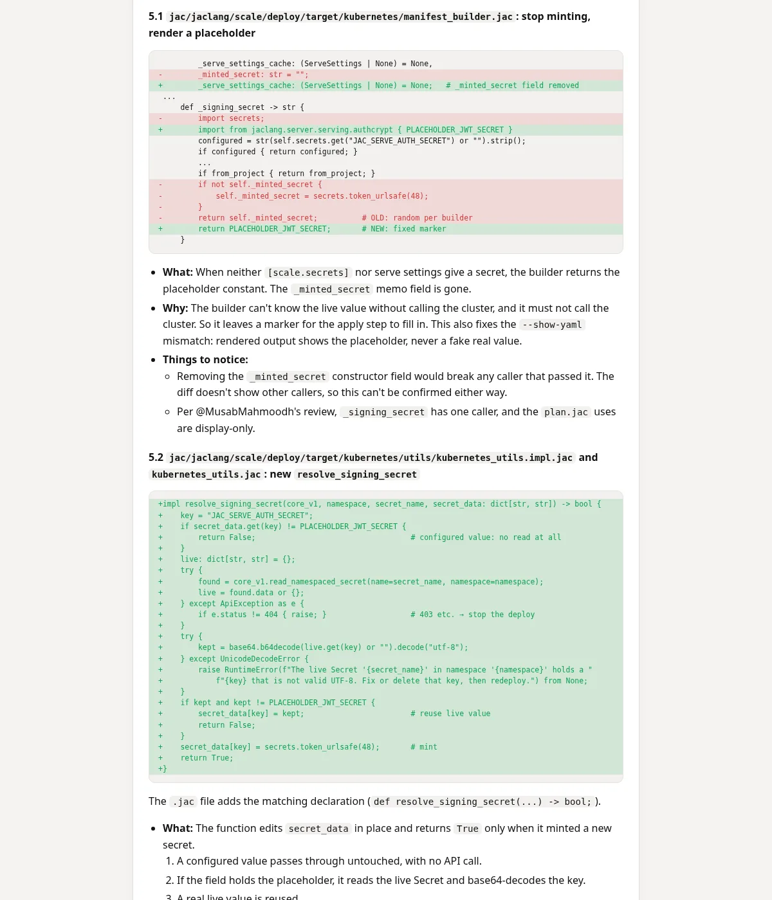
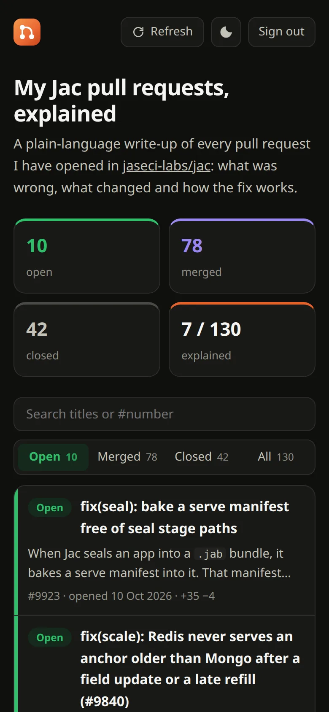

<p align="center">
  
</p>

<h1 align="center">jac-pr-explainers</h1>

<p align="center">
  A plain-language explainer for every pull request I open in <a href="https://github.com/jaseci-labs/jac">jaseci-labs/jac</a>,<br>
  written to help me explain each change to a senior engineer. It's written automatically every hour and shown on a private website.
</p>

<p align="center">
  <a href="#features">Features</a> ·
  <a href="#screenshots">Screenshots</a> ·
  <a href="#how-it-works">How it works</a> ·
  <a href="#setup">Setup</a> ·
  <a href="#configuration">Configuration</a> ·
  <a href="#run-locally">Run locally</a>
</p>

<p align="center">
  
  
  
  
  
</p>



## Why

A PR's diff shows *what* changed, but not the background you need to talk about it: what each term means, why the old behaviour was wrong, and how the code runs after the fix. This project writes that background for every PR, in simple English, so I can explain any of my changes clearly to a senior engineer, even in a part of the codebase I'm new to.

## Features

### Explainers

Each explainer is a review-style document written for the PR's author, as someone new to that part of the codebase who has to present the PR to a senior. It starts with the facts: PR and linked issue, author, state, the commit it describes, and lines changed in production code, tests and release notes. Then it has 11 numbered sections:

| Section | What it covers |
| --- | --- |
| **1. The short version** | The problem and the fix, with the key sentences in bold, and where the PR stands now. |
| **2. Words you need to know** | A table of every term the PR needs, in simple words, ordered so each builds on the last. It marks where the bug lives. |
| **3. The problem, step by step** | The setup, a numbered timeline of what went wrong (with values as they change), and why it mattered. |
| **4. The idea of the fix** | The fix in one sentence, and why it's the right idea. |
| **5. Every code change, explained** | Each file's diff hunks, coloured, with **What**, **Why** and **Things to notice**. |
| **6. How execution flows after the PR** | Call trees from trigger to result, with new and changed steps marked, plus a before/after table of scenarios. |
| **7. Test changes, explained** | Test counts before and after, and what each test (or table row) sets up and proves. |
| **8. CI and checks** | The results of the CI runs on the commit it describes. |
| **9. Review comments and their status** | Each reviewer's comments, marked Fixed (with the commit), Answered or Open. |
| **10. Is it ready to merge?** | A verdict, the reasons, and what to do before merging, including where the PR description has fallen behind the code. |
| **11. Questions your senior might ask** | Likely questions, with short answers. |

To write it, the model gets the PR's description, linked issues, commits, reviews and comments, CI results and diff. It only states what those show. When something can't be told from them, or part of the diff had to be left out, it says so instead of guessing.

### Automation

| Feature | What it does |
| --- | --- |
| **Hourly job** | A GitHub Actions workflow finds every PR by the author in the source repo and writes the missing explainers. |
| **Kept up to date** | A PR that gets new commits is explained again for its latest commit. Merged and closed PRs keep their explainers. |
| **Prompt versioning** | Each explainer records the prompt version it was written with. When the prompt changes, older explainers are rewritten. |
| **Newest first** | New PRs are explained before older ones, so a backfill never delays a PR you just opened. |
| **Fits the diff to the model** | Lockfiles and generated files are left out, source files come before tests, and long diffs are trimmed to a size budget. A request that is still too long is retried with half the diff. |
| **Polite to usage limits** | At most 10 explainers per run (configurable), with a pause between requests. On a usage limit the run stops and the next one carries on. A PR that fails 3 times is skipped until it changes. |
| **Re-explain on demand** | Run the workflow manually with PR numbers to write their explainers again. |
| **Quiet history** | Runs that change nothing don't commit. Commits name the PRs they explain, e.g. `Explain #9911, #9836, #9740`. |
| **Readable on GitHub** | Explainers are plain Markdown files in [`site/explainers/`](site/explainers), one per PR. |

### Models

| Option | How |
| --- | --- |
| **Claude subscription** (default) | Uses the Claude Code CLI with a token from `claude setup-token`. It runs on your Pro or Max plan's usage, with no API billing. |
| **Any OpenAI-compatible API** | Gemini (free tier), Groq, OpenRouter, OpenAI or a local Ollama, set with `LLM_PROVIDER=openai`. |

### Website

| Feature | What it does |
| --- | --- |
| **Private** | Every page and file needs a sign-in with username and password. The server won't start without a password, so it can't go public by accident. |
| **Secure sessions** | Signed, HttpOnly, SameSite cookies that last 30 days. Failed sign-ins are slowed down. Changing the password signs every session out. |
| **Open PRs first** | The list opens on your open PRs, the ones still in review. Open / Merged / Closed / All filters show how many PRs each holds. Search works by title or number. |
| **Colour-coded states** | Green for open, purple for merged, grey for closed, with a coloured edge and label on every row. Drafts get an outlined *Draft* label. The counts at the top use the same colours. |
| **Summaries in the list** | Each row shows the explainer's bug and fix lines under the title, so you can tell what a PR does without opening it. |
| **Status notes** | *Explainer not written yet* for PRs still waiting. *New commits since the explainer* when the PR changed after its explainer was written. |
| **Explainer page** | Shows the PR's state, dates, size and GitHub link above the rendered explainer. Diff lines are coloured green and red, and the Markdown is sanitized before display. |
| **Refresh button** | Fetches your current PRs from GitHub straight away, so new ones appear at once. It then starts the job and shows its progress, and reloads when the new explainers are in. |
| **Always current** | The site reads explainers from this repo on request, cached briefly and revalidated with ETags. New explainers appear without a redeploy. |
| **Light and dark** | Follows the system theme, with a toggle that's remembered. |
| **Phone friendly** | The layout works down to small phone screens. |

## Screenshots

| Sign-in | Light theme |
| --- | --- |
|  |  |

| An explainer | On a phone |
| --- | --- |
|  |  |

## How it works

```
                 every hour, or the Refresh button
                               │
                               ▼
┌──────────────────── GitHub Actions: Explain PRs ────────────────────┐
│ 1. Find the author's PRs in jaseci-labs/jac                         │
│ 2. Pick PRs with no explainer, new commits, or an older prompt      │
│ 3. For each: description + commits + diff ──► model ──► <number>.md │
│ 4. Commit site/explainers/ (the .md files and index.json)           │
└─────────────────────────────────────────────────────────────────────┘
                               │
                               ▼
                   this repo, site/explainers/
                               │  read on request
                               ▼
┌──────────────── Website on Render (sign-in required) ───────────────┐
│ PR list · search and filters · explainer pages · Refresh            │
└─────────────────────────────────────────────────────────────────────┘
```

When you press **Refresh**, the server does two things:

1. It fetches your PRs from GitHub itself and lays the result over the saved list, so new and updated PRs show at once.
2. It starts the workflow. The page checks the run every 5 seconds and reloads the explainers when it finishes.

## Setup

### 1. Let the job use your Claude subscription

```sh
claude setup-token        # approve in the browser; prints a token valid for one year
gh secret set CLAUDE_CODE_OAUTH_TOKEN -R akindu-k/jac-pr-explainers   # paste it
```

The token uses the same plan as your own Claude use and isn't billed separately. It counts toward your usage limits.

### 2. Make a token for the website

Create a [fine-grained personal access token](https://github.com/settings/personal-access-tokens/new) with these settings:

- **Repository access:** only `akindu-k/jac-pr-explainers`
- **Permissions:** Contents *Read-only*, Actions *Read and write*

The site uses it to read the explainers and to start the job from the Refresh button.

### 3. Deploy the website on Render

**New → Blueprint** on Render, then pick this repo. [`render.yaml`](render.yaml) sets up a free web service. When asked, fill in:

| Variable | Value |
| --- | --- |
| `AUTH_PASSWORD` | the password you'll sign in with; the username is `akindu-k` |
| `GITHUB_TOKEN` | the token from step 2 |

The Blueprint ignores commits that only touch `site/explainers/`, so the job's commits don't trigger redeploys. Like any free Render service, the site sleeps when idle. The first visit after a while takes about a minute.

## Configuration

### Job (repository secrets and variables)

| Name | Default | |
| --- | --- | --- |
| `CLAUDE_CODE_OAUTH_TOKEN` (secret) | | From `claude setup-token` |
| `LLM_MODEL` | `claude-opus-5-5` | Any model Claude Code accepts, e.g. `claude-sonnet-5-5` to use less of your plan |
| `LLM_EFFORT` | `medium` | How hard the model thinks: `low`, `medium`, `high`, `xhigh` or `max` |
| `MAX_PER_RUN` | `10` | Most explainers per run |
| `MAX_INPUT_CHARS` | `120000` | How much PR text to send per request |
| `SOURCE_REPO` | `jaseci-labs/jac` | Where to look for PRs |
| `PR_AUTHOR` | `akindu-k` | Whose PRs to explain |
| `LLM_PROVIDER` | `claude-code` | `openai` for an OpenAI-compatible API |
| `LLM_BASE_URL`, `LLM_API_KEY` (secret) | | For `openai`, e.g. `https://generativelanguage.googleapis.com/v1beta/openai` with `LLM_MODEL=gemini-3.8-flash` |

To explain specific PRs again, open **Actions → Explain PRs → Run workflow**. Enter the numbers in *prs* (e.g. `9923, 9911`), and optionally a larger *max*.

### Website (environment variables)

| Name | Default | |
| --- | --- | --- |
| `AUTH_USERNAME` | `akindu-k` | The one account that can sign in |
| `AUTH_PASSWORD` | | Required |
| `GITHUB_TOKEN` | | Reads explainers and starts the job. Without it, Refresh only updates the PR list. |
| `CONTENT_REPO` | | The repo to read explainers from. Unset: the local `site/explainers/` |
| `CONTENT_BRANCH` | `main` | |

## Run locally

Requires Node.js 22.13 or newer.

```sh
npm install
cp .env.example .env                            # set AUTH_PASSWORD
GITHUB_TOKEN=$(gh auth token) npm run explain   # uses your local Claude Code login
npm start                                       # http://localhost:3000
npm test
```

`ONLY_PRS=9923 npm run explain` writes one PR's explainer again.

## Layout

```
src/run.js          the job: sync PRs, pick what needs explaining, write the files
src/sync.js         bring the PR list up to date with GitHub
src/prompt.js       the prompt, fitting the diff to a budget, and the .md format
src/llm.js          Claude Code CLI, or any OpenAI-compatible API
src/store.js        index.json, the queue, and merging a refresh into it
src/github.js       GitHub REST calls
server/             the website: sign-in, explainers from the repo, refresh
site/               the pages the server serves
site/explainers/    one <number>.md per PR, and index.json
test/               unit and server tests (node --test)
```
